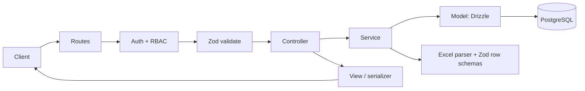

# Student Progress Analytics: Backend PRD

Oct 26, 2026 · @Arun

This backend stores LMS report snapshots for many users and batches, computes improvement metrics, and serves them through a REST API built with Node.js, Express, TypeScript, Drizzle ORM (`pg`), Zod and an MVC structure. It is the server counterpart of the frontend-only app, adding multi-user access, shared history and cross-device sync.

---

## 1. Overview

### 1.1 Problem

The frontend-only version keeps data in one browser, so history is lost when the device changes, nothing is shared between trainers and managers, and large reports are parsed on the client. A backend gives one trusted store, access control and reliable trend history.

### 1.2 Goals

1. Accept the LMS Excel export (5 sheets) and store it as an immutable, dated **snapshot**.
2. Serve batch trends, snapshot comparisons, student history and at-risk lists through a typed REST API.
3. Support users with roles (Admin, Manager, Trainer) and per-batch access.
4. Validate every request and every parsed row with Zod.
5. Keep the code in a clear MVC layout so it is easy to test and extend.

### 1.3 Non-goals (v1)

- Real-time LMS sync (the API leaves room for a scheduled importer later).
- Student-facing access, grading, or messaging.
- Machine-learning predictions.
- Multi-tenant billing.

### 1.4 Users and roles

| Role | Can do |
| --- | --- |
| **Admin** | Manage users, batches, thresholds; delete data; see audit log |
| **Manager** | Read all batches, compare, export reports; cannot upload |
| **Trainer** | Upload and read only assigned batches; add follow-up notes |

---

## 2. Tech stack

| Concern | Choice |
| --- | --- |
| Runtime / language | Node.js 20 LTS, TypeScript (strict) |
| Web framework | Express.js 4 |
| Database | PostgreSQL 15+ |
| DB driver | `pg` (node-postgres) connection pool |
| ORM and migrations | Drizzle ORM (`drizzle-orm/node-postgres`) + `drizzle-kit` |
| Validation | Zod (request body, query, params, env, parsed Excel rows) |
| File upload | `multer` (memory storage, 25 MB limit) |
| Excel parsing | `exceljs` (values only, no formula evaluation) |
| Auth | JWT access + refresh tokens, `argon2` password hashing |
| Security middleware | `helmet`, `cors`, `express-rate-limit` |
| Logging | `pino` + `pino-http` (PII redacted) |
| Testing | Vitest + Supertest, Testcontainers for Postgres |
| Docs | OpenAPI generated from Zod schemas (`zod-to-openapi`) |
| Process / deploy | Docker, `docker-compose` for dev |

---

## 3. Product requirements

### 3.1 Source data (same as the LMS export)

| Sheet | Key fields |
| --- | --- |
| Cumulative Report | Student ID, Name, Phone, Total Consumption %, Video %, PDF %, Quiz %, Flash Cards %, AI Content %, Assignment Submission %, Assignment Aggregate Score %, Live Class %, Live Or Recording %, and raw consumed/total counts |
| Assignments | User ID, Name, Phone, one column per assignment as `STATUS / score`, Total, Submitted, Not Submitted, Delayed, Submission Rate %, Total Score, Max Score |
| Content Consumption | User ID, Name, Phone, `Week N (Consumed/Total)` for each week, Total Content, Total Consumed |
| Live Attendance | Name, Phone, one column per session (PRESENT / ABSENT / PARTIAL), Attendance % |
| Attendance (Live+Recording) | Same layout, counting recording views |

**Parsing rules**

- Percent fields may be numbers (`22.37`) or strings (`"20.7%"`); normalize to a number.
- Assignment cells split on `/` into status and score; `-` means null.
- Week cells split `a/b` into consumed and total.
- Attendance sheets have no Student ID; join on E.164 phone, fall back to name.
- Session column names end with a date (`DD-MM-YYYY`); parse it as the session date.
- Weeks, assignments and sessions change between exports; parse columns dynamically.

### 3.2 Functional requirements

| ID | Requirement | Priority |
| --- | --- | --- |
| B1 | Register / login, refresh token, logout; password reset by Admin | P0 |
| B2 | Role-based access control and per-batch assignment of trainers | P0 |
| B3 | CRUD for batches | P0 |
| B4 | `POST` upload of `.xlsx` with batch and snapshot date; async-safe processing with status | P0 |
| B5 | Zod validation of every parsed row; return a structured error report (errors block, warnings allow) | P0 |
| B6 | Immutable snapshots; re-upload for the same batch and date replaces after an explicit `replace=true` flag | P0 |
| B7 | Batch overview endpoint: latest values, delta in percentage points vs previous snapshot, trend series | P0 |
| B8 | Compare two snapshots: improved / same / declined lists and segment movement matrix | P0 |
| B9 | At-risk endpoint with reasons, filters and CSV export | P0 |
| B10 | Per-assignment, week-wise content and per-session attendance endpoints | P1 |
| B11 | Student profile endpoint with history across snapshots | P1 |
| B12 | Follow-up notes with owner and status per student | P1 |
| B13 | Configurable thresholds (segments, delta tolerance, at-risk rules) | P1 |
| B14 | Excel / CSV report export | P1 |
| B15 | Audit log of uploads, deletes, exports and role changes | P1 |
| B16 | Bulk import / export of all batch data as JSON (migration from the frontend-only app) | P2 |

### 3.3 Metric definitions

- **Delta** = new value minus old value, in percentage points.
- **Improved / Same / Declined:** change of +2 pts or more, within 2 pts, or -2 pts or less (configurable).
- **Segments:** High (80% or more), Medium (50 to 79%), Low (below 50%).
- **Zero submitters:** Assignments Submitted = 0.
- **Recording-only learner:** Live % below 30% and Live-or-Recording % above 70%.
- **Attends but does not submit:** Live % at or above 70% and Assignment Submission % below 25%.
- **At-risk:** any of zero submissions, consumption below 50%, attendance below 50%, or zero quiz attempts (rules configurable).

### 3.4 Non-functional requirements

- Upload of a 500-student, 5-sheet file processed in under 10 seconds.
- Read endpoints respond in under 300 ms at p95 for a batch of 500 students and 50 snapshots.
- All write paths idempotent where possible; ingestion runs in one DB transaction (all or nothing).
- PII (name, phone) encrypted in transit (TLS), redacted in logs, accessible only to authorised roles.
- 80% or more test coverage on services and parsers.
- Zero-downtime migrations through Drizzle Kit.

### 3.5 Success metrics

- A manager report is produced in under 5 minutes after upload.
- 100% of sample and future exports parse without manual edits.
- No unauthorised cross-batch access in security tests.

---

## 4. Architecture (MVC)

### 4.1 Layers

| Layer | Responsibility | Lives in |
| --- | --- | --- |
| **Model** | Drizzle table schemas and data-access functions (queries only, no HTTP) | `src/models` |
| **View** | Response serializers (DTO mappers) that shape JSON and hide internal fields | `src/views` |
| **Controller** | Parse validated input, call a service, return a view; no business rules | `src/controllers` |
| **Service** (business layer) | Ingestion, analytics, comparison, at-risk logic; pure and unit-testable | `src/services` |
| **Routes / middleware** | Wire URLs to controllers; auth, validation, rate limiting, error handling | `src/routes`, `src/middleware` |

Request flow: `route → auth middleware → Zod validate middleware → controller → service → model (Drizzle) → view → JSON response`.



### 4.2 Folder structure

```text
src/
  app.ts                 express app, middleware, routes
  server.ts              bootstrap, graceful shutdown
  config/env.ts          zod-validated environment variables
  db/
    client.ts            pg Pool + drizzle()
    schema/              table definitions (one file per table)
    migrations/          drizzle-kit output
  models/                batch.model.ts, snapshot.model.ts, student.model.ts ...
  views/                 batch.view.ts, compare.view.ts, student.view.ts ...
  controllers/           auth, batch, upload, analytics, student, followup
  services/
    ingestion/           detectSheets, parsers, identityResolver, validator, loader
    analytics/           deltas, segments, atRisk, insights
    auth.service.ts
  routes/                index.ts + one router per resource
  middleware/            authenticate, authorize, validate, upload, errorHandler, rateLimit
  validators/            zod schemas for params, query, body, excel rows
  utils/                 phone.ts, dates.ts, percent.ts, logger.ts
  tests/                 unit, integration, fixtures (sample .xlsx)
```

### 4.3 Database schema (Drizzle, PostgreSQL)

```ts
users(id uuid pk, email unique, password_hash, role enum('admin','manager','trainer'), created_at)
batches(id uuid pk, name, external_batch_id unique, start_date, created_at)
batch_trainers(batch_id fk, user_id fk)                       // pk (batch_id, user_id)
students(id uuid pk, external_student_id unique, name, phone_e164, created_at)
batch_students(batch_id fk, student_id fk)                    // pk (batch_id, student_id)
uploads(id uuid pk, batch_id fk, uploaded_by fk, file_hash, status enum('processing','done','failed'), error_report jsonb, created_at)
snapshots(id uuid pk, batch_id fk, upload_id fk, snapshot_date date, parser_version int, unique(batch_id, snapshot_date))
student_snapshots(id, snapshot_id fk, student_id fk,
  total_consumption_pct, video_pct, pdf_pct, quiz_pct, flashcards_pct, ai_content_pct,
  assignment_submission_pct, assignment_score_pct, live_pct, live_or_rec_pct,
  assignments_total, assignments_submitted, assignments_delayed,
  live_total, live_attended, segment enum('high','medium','low'), raw jsonb)   // index (snapshot_id, student_id)
assignment_items(id, snapshot_id fk, name)
assignment_results(assignment_item_id fk, student_id fk, status, score, max_score)
weekly_consumption(snapshot_id fk, student_id fk, week_no, consumed, total)
sessions(id, snapshot_id fk, title, session_date)
attendance(session_id fk, student_id fk, live_status, live_or_rec_status)
followups(id, student_id fk, snapshot_id fk, owner_id fk, note, status enum('open','in_progress','done'), created_at)
settings(key pk, value jsonb)
audit_logs(id, user_id fk, action, entity, entity_id, meta jsonb, created_at)
```

Batch-level aggregates and deltas are computed from `student_snapshots` at read time (cached by `snapshot_id`), so a threshold change re-computes everything without migrations.

### 4.4 Ingestion pipeline

1. `multer` receives the file in memory; the middleware checks size, extension and magic bytes.
2. A SHA-256 hash is computed; a duplicate hash for the same batch returns the earlier upload.
3. `exceljs` reads values only. Sheet detectors match by name, falling back to header signature.
4. Per-sheet parsers normalize values (percents, `STATUS / score`, `a/b`, attendance codes, session dates).
5. Each row is parsed with a **Zod row schema**; failures are collected with sheet, row and column.
6. The identity resolver joins sheets by Student ID, then phone, then name; unmatched rows are reported.
7. If there are no blocking errors, the loader writes the snapshot and all fact rows in **one Drizzle transaction**.
8. The upload row is marked `done` or `failed` with the error report; an audit log entry is written.

### 4.5 Validation with Zod

- `validate({ body, query, params })` middleware parses each part and replaces it with the typed result; failure returns `400` with the error list.
- `env.ts` parses `process.env` at start-up and exits on invalid configuration.
- Row schemas use `z.coerce.number().min(0).max(100)` for percents, enums for statuses, and refinements for "consumed not more than total".
- The same schemas generate the OpenAPI document and TypeScript types (`z.infer`).

### 4.6 REST API (`/api/v1`)

| Method | Path | Role | Purpose |
| --- | --- | --- | --- |
| POST | /auth/login, /auth/refresh, /auth/logout | public | Authentication |
| GET / POST | /users, PATCH /users/:id | admin | Manage users and roles |
| GET / POST | /batches | all / admin | List and create batches |
| GET / PATCH / DELETE | /batches/:id | all / admin | Batch detail and changes |
| POST | /batches/:id/trainers | admin | Assign trainers |
| POST | /batches/:id/uploads | admin, trainer | Upload report (`replace` flag optional) |
| GET | /uploads/:id | admin, trainer | Processing status and error report |
| GET | /batches/:id/snapshots | all | List snapshots |
| GET | /batches/:id/overview | all | Scorecards, trend series, segment counts |
| GET | /batches/:id/compare?from=&to= | all | Deltas, movement lists, segment matrix |
| GET | /batches/:id/assignments | all | Per-assignment stats |
| GET | /batches/:id/content | all | Week-wise consumption |
| GET | /batches/:id/attendance | all | Session stats |
| GET | /batches/:id/at-risk | all | At-risk list (supports `format=csv`) |
| GET | /students/:id | all | Profile with history |
| GET / POST / PATCH | /followups | admin, trainer | Follow-up notes |
| GET | /batches/:id/report?format=xlsx | admin, manager | Report export |
| GET / PUT | /settings/thresholds | admin | Configuration |
| GET | /health | public | Liveness and DB check |

**Conventions:** pagination with `page` and `pageSize`; sorting with `sort`; JSON error shape `{ "code", "message", "details" }`; HTTP codes `200, 201, 400, 401, 403, 404, 409, 413, 422, 429, 500`.

### 4.7 Security

- `argon2id` password hashing; JWT access token (15 minutes) and rotating refresh token stored hashed.
- RBAC middleware plus a per-batch ownership check for trainers on every `/batches/:id/*` route.
- `helmet`, strict CORS allow-list, rate limit on login and upload, request body size limits.
- Parameterised queries only (Drizzle); Excel read as values, never executed.
- PII redacted in `pino` logs; database and backups encrypted at rest; secrets only from environment.
- Audit log for uploads, deletes, exports, role changes.

### 4.8 Testing and CI/CD

- **Unit:** parsers, identity resolver, delta, segment and at-risk services using the real sample export.
- **Integration:** Supertest against a Testcontainers Postgres for auth, upload, compare and RBAC cases.
- **Golden test:** the sample file must give 31 students, assignment submission average 62.1%, consumption average 67.8%, live attendance average 72.9%.
- **CI:** lint, type-check, tests, build Docker image, run `drizzle-kit migrate` on staging, manual promotion to production.

### 4.9 Deployment

Dockerised Express app behind a reverse proxy with TLS, managed PostgreSQL with daily backups, environment variables for `DATABASE_URL`, `JWT_SECRET`, `REFRESH_SECRET`, `CORS_ORIGINS`.

---

## 5. Milestones

| Phase | Scope | Duration |
| --- | --- | --- |
| M1 | Project setup, env validation, Drizzle schema and migrations, auth and RBAC | 1.5 weeks |
| M2 | Excel ingestion pipeline, Zod row validation, snapshots, upload status | 2 weeks |
| M3 | Overview, compare, at-risk, assignment, content and attendance endpoints | 2 weeks |
| M4 | Student profile, follow-ups, exports, audit log, thresholds | 1 week |
| M5 | Hardening, OpenAPI docs, load tests, deployment | 1 week |

## 6. Risks

| Risk | Mitigation |
| --- | --- |
| LMS export layout changes | Dynamic column parsing, `parser_version`, schema-driven validation |
| Students missing in some sheets | Unmatched-row report and manual match endpoint |
| Large files block the event loop | Stream with `exceljs`, limit size, move to a job queue (BullMQ) if needed |
| PII exposure | RBAC, log redaction, encryption, audit log |
| Different denominators between exports | Store totals, compare percentages only |

## 7. Open questions

1. Does the LMS provide an API or scheduled export, so ingestion can be automated?
2. Should a student be trackable across multiple batches?
3. What target values does management use (for example 80% assignment submission)?
4. Is Flash Cards content planned? If not, hide it in responses.
5. Does the frontend-only app's data need to be imported (B16)?

---

## 8. Build prompt for a coding agent

```text
You are a senior backend engineer. Build the "Student Progress Analytics" backend described in the attached PRD.

STACK (fixed)
Node.js 20, Express.js, TypeScript (strict), PostgreSQL with Drizzle ORM and the `pg` package, Zod for all validation, MVC structure (models, views, controllers + a services layer).

RULES
- Follow the folder structure, schema, API table and ingestion pipeline in the PRD.
- Validate env, params, query, body and every parsed Excel row with Zod; infer types with z.infer; no `any`.
- Use Drizzle migrations (drizzle-kit); the whole snapshot load must run in one transaction.
- Controllers contain no business logic; services are pure and unit-tested; views shape every response.
- Implement JWT auth, argon2id, RBAC and per-batch access checks, helmet, CORS, rate limits, pino with PII redaction.
- Parse the .xlsx with exceljs (values only). Use the attached sample file as the test fixture.
- Golden test: 31 students, assignment submission average 62.1%, consumption average 67.8%, live attendance average 72.9%.
- Provide OpenAPI docs generated from the Zod schemas, a Dockerfile, docker-compose (api + postgres) and a README.

HOW TO WORK
1. Read the whole PRD, then reply with a plan per milestone (M1 to M5), assumptions and questions. Wait for my confirmation.
2. Build one milestone at a time; after each, run lint, type-check and tests, summarise what was built, and list open items.
3. Do not add features outside the PRD; ask before changing the schema.
```
