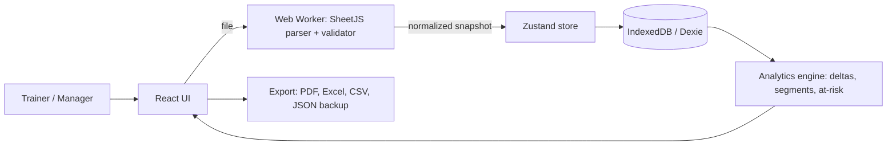

# Student Progress Analytics Platform

*PRD, Design Document, Architecture and Build Prompt*

Author: Senior Full Stack Engineer | Version 1.0 | Date: 25 Oct 2026

---

## 1. Overview

### 1.1 Problem

Trainers and program managers receive a "Cumulative Report" Excel export (example: Batch 15748, 31 students, 5 sheets) from the LMS. Each export is a single snapshot. There is no dated history, so nobody can answer: *"Is the batch improving in assignments, content consumption and attendance?"* Analysis is done by hand in Excel, which is slow, inconsistent and hard to present to managers.

### 1.2 Vision

A frontend-only web app with no backend, database server or login. The trainer uploads each new export, the browser parses it, saves it on the device as a dated snapshot, compares it with earlier snapshots, and shows improvement at batch and student level with charts, an at-risk list and a manager-ready report.

### 1.3 Goals

1. Ingest the LMS Excel report with no manual cleanup.
2. Show batch-level trend for **Assignments, Content, Attendance** across snapshots.
3. Show per-student movement: improved, same, declined.
4. Flag at-risk students automatically and give a follow-up list.
5. Export a one-page manager report (PDF / Excel).

### 1.4 Non-goals (v1)

- Any backend, API, server database or user accounts (all data stays in the browser).
- Replacing the LMS or editing LMS data.
- Real-time sync with the LMS or sync across devices (v2 would need a backend).
- Grading or student-facing views.
- Predictive ML (planned for v2).

---

## 2. Product Requirements (PRD)

### 2.1 Users and personas

| Persona | Needs |
| --- | --- |
| **Trainer / Mentor** | Upload reports, see who needs follow-up, track individual students |
| **Program Manager** | Batch scorecard, trend, one-page report; usually receives the exported PDF or opens the app on the trainer's device |

### 2.2 Source data (from the sample file)

| Sheet | Key fields |
| --- | --- |
| Cumulative Report | Student ID, Name, Phone, Total Consumption %, Video %, PDF %, Quiz Submission %, Flash Cards %, AI Content %, Assignment Submission %, Assignment Aggregate Score %, Live Class %, Live Or Recording %, plus raw totals/consumed counts for PDF, Video, Quiz, Flash Cards, AI Content, Assignments, Live Class |
| Assignments | User ID, Name, Phone, one column per assignment as `STATUS / score` (e.g. `PASSED / 10`, `SUBMISSION_PENDING / -`), Total, Submitted, Not Submitted, Delayed, Submission Rate %, Total Score, Max Score, Aggregate % |
| Content Consumption | User ID, Name, Phone, `Week N (Consumed/Total)` for Weeks 1 to 10, Total Content, Total Consumed, Aggregate % |
| Live Attendance | Name, Phone, one column per session (PRESENT / ABSENT / PARTIAL), Attendance % |
| Attendance (Live+Recording) | Same layout, counts recording views as attendance |

**Parsing rules:**

- Percent fields can be numbers (`22.37`) or strings (`"20.7%"`); normalize to float.
- Assignment cells: split on `/` into status and score; `-` means null.
- Week cells: split `a/b` into consumed and total.
- Attendance sheets have no Student ID; join on normalized phone number (E.164), fallback to name.
- Session column names embed the date (`...-21-10-2026`); parse it as the session date.
- Column sets change between exports (new weeks, assignments, sessions); parse dynamically and never hard-code columns.

### 2.3 Functional requirements

| ID | Requirement | Priority |
| --- | --- | --- |
| F1 | Drag-and-drop `.xlsx` upload for a batch with a snapshot date (default: today, editable); parsing runs in the browser | P0 |
| F2 | Validate file: required sheets and columns present, row counts, duplicates; show a clear error report | P0 |
| F3 | Save each upload as an immutable snapshot in IndexedDB; re-upload for the same date replaces after confirmation | P0 |
| F4 | Batch dashboard with scorecard for Assignment, Content, Attendance (latest value, change vs previous snapshot in percentage points, arrow) | P0 |
| F5 | Trend charts across all snapshots per metric | P0 |
| F6 | Student segmentation: High (80% or more), Medium (50 to 79%), Low (below 50%); thresholds configurable | P0 |
| F7 | Compare any two snapshots: improved, same, declined counts and student lists | P0 |
| F8 | At-risk list with reasons (e.g. 0 assignments, consumption below 50%, attendance below 50%) and CSV export | P0 |
| F9 | Backup and restore: export all data to one JSON file and import it back (data lives per browser) | P0 |
| F10 | Student profile page with metric history and week-wise consumption | P1 |
| F11 | Per-assignment view: submission rate, on-time vs delayed, average score | P1 |
| F12 | Cross-metric insights (attends but does not submit, recording-only learner) | P1 |
| F13 | One-page manager report (PDF) and detailed Excel export, generated in the browser | P1 |
| F14 | Settings (thresholds, language) and delete-batch / clear-all-data, saved locally | P1 |
| F15 | Follow-up notes and status per at-risk student, stored locally | P2 |
| F16 | Compare batches side by side | P2 |

### 2.4 Metric definitions

- **Delta** = new value minus old value, in percentage points.
- **Improved / Same / Declined:** change of +2 pts or more, within 2 pts, or -2 pts or less (threshold configurable).
- **Zero submitters:** students with Assignments Submitted = 0.
- **Moved up a segment:** Low to Medium, Medium to High, etc.
- **Recording-only learner:** Live % below 30% and Live-or-Recording % above 70%.
- **Attends but does not submit:** Live % at or above 70% and Assignment Submission % below 25%.

### 2.5 Non-functional requirements

- Parsing a 5-sheet, 500-student file takes under 3 seconds, in a Web Worker so the UI never freezes.
- Dashboard renders in under 1 second from local data.
- Privacy: student data never leaves the browser; no analytics or network calls carry names or phone numbers.
- Works offline after the first load (PWA, P1).
- Latest Chrome, Edge, Firefox and Safari; usable on tablet and desktop; WCAG AA.

### 2.6 Success metrics

- Time to produce a manager report drops from hours to under 5 minutes.
- 100% of uploads parse without manual edits.
- Trainers use the at-risk list weekly.

### 2.7 Milestones

| Phase | Scope | Duration |
| --- | --- | --- |
| M1 | Upload, in-browser parsing, validation, IndexedDB snapshots | 1.5 weeks |
| M2 | Dashboard, trends, comparison, at-risk list | 2 weeks |
| M3 | Student profile, assignment view, PDF / Excel export, backup and restore | 1.5 weeks |
| M4 | Tests, accessibility, PWA, static-hosting deploy | 1 week |

### 2.8 Risks

| Risk | Mitigation |
| --- | --- |
| LMS export format changes | Dynamic column parsing, schema validation, parser versioning |
| Browser data cleared or device changed | Backup / restore to JSON, reminder after each upload |
| Students missing in some sheets | Unmatched-rows report; manual match UI |
| Phone formats differ | Normalize to E.164 |
| Misleading trends from different denominators | Store totals; compare percentages only |
| No login, so anyone on the device sees PII | Optional passcode lock; clear-all-data button; advise a private device |

---

## 3. Design Document

### 3.1 Information architecture

1. **Batches** list
2. **Batch Dashboard** (tabs: Overview, Assignments, Content, Attendance, Students, Compare)
3. **Student Profile**
4. **Upload** wizard
5. **Reports** (export)
6. **Settings** (thresholds, users)

### 3.2 Key screens

**Upload wizard:** drag and drop file, choose batch and snapshot date, preview detected sheets and row counts, validation results (errors block, warnings allow), confirm.

**Overview dashboard:**

- Top row: three scorecards (Assignment, Content, Attendance), each showing current %, delta in pts vs previous snapshot and a sparkline.
- Middle: line chart of the three metrics over snapshots; stacked bar of High / Medium / Low segment counts per snapshot.
- Bottom left: Top improvers (5). Bottom right: Needs attention (5) with reason chips.

**Compare view:** pick snapshot A and B; table with metric, A, B, delta, arrow; tabs for Improved, Same, Declined student lists; segment-movement matrix (rows: A segment, columns: B segment).

**Assignments tab:** per-assignment bars (submitted, pending, delayed), average score, list of non-submitters per assignment.

**Content tab:** week-wise heatmap (students by weeks, colored by consumed/total) to show where drop-off starts; video, PDF, quiz, AI content breakdown.

**Attendance tab:** live vs live-or-recording per student, session-wise attendance rate bar chart, list of recording-only learners.

**Student profile:** header with ID, name, segment; metric history lines; week-wise consumption; assignment status list; attendance timeline; notes.

### 3.3 UX rules

- Always show change as signed points with an arrow and color (green up, red down, grey flat), plus text so it is not color-only.
- Every chart has a table toggle.
- Empty and error states explain what to do next.
- Segment colors consistent across the app.

### 3.4 Component library

React with TypeScript, Tailwind CSS, shadcn/ui, Recharts for charts, TanStack Table for data tables.

---

## 4. Architecture (Frontend Only)

### 4.1 Style

A single-page application served as static files. Parsing, storage, analysis, charts and exports all run in the browser. There is no server, API or database to deploy or secure.

### 4.2 Stack

| Layer | Choice | Reason |
| --- | --- | --- |
| Framework | React + TypeScript + Vite | Fast builds, typed, large chart ecosystem |
| Excel parsing | SheetJS (`xlsx`) inside a Web Worker | Reads `.xlsx` in the browser without blocking the UI |
| Validation | Zod | Typed schema checks for parsed rows |
| Local storage | IndexedDB via Dexie | Structured, queryable, holds large data (localStorage is too small) |
| State | Zustand + Dexie `liveQuery` | Simple global state, auto-refresh from the database |
| UI | Tailwind CSS + shadcn/ui | Consistent, accessible components |
| Charts and tables | Recharts, TanStack Table | Trends, bars, heatmap; sortable, filterable lists |
| Export | jsPDF + html2canvas (PDF), SheetJS (Excel), PapaParse-style CSV | All generated client-side |
| Routing | React Router | Dashboard, student and settings pages |
| Hosting | Static host (Netlify, Vercel, Cloudflare Pages or GitHub Pages) | Free, no server to run |

### 4.3 System diagram



### 4.4 Ingestion pipeline (all in the browser)

1. The user drops a `.xlsx` file; the UI checks size (25 MB max) and extension, then hands the bytes to a Web Worker.
2. The worker reads the workbook (values only, formulas are never evaluated) and detects sheets by name, falling back to header signature.
3. **Parsers** normalize values: percent strings, `STATUS / score`, `a/b` week cells, attendance codes, session dates from column names.
4. **Identity resolver** joins sheets by Student ID where present, else normalized phone, else fuzzy name; unmatched rows go to a review list.
5. **Validator** checks required columns, ranges (0 to 100), duplicate IDs, and totals consistency (consumed not more than total).
6. The UI shows a preview with errors (block) and warnings (allow), then the user confirms the snapshot date.
7. The snapshot is written to IndexedDB in one transaction; the file hash is stored to detect duplicate uploads.
8. The analytics engine computes batch aggregates, segments and deltas versus the previous snapshot on demand and memoizes them.

### 4.5 Local data model (Dexie stores)

```ts
batches:          id, name, externalBatchId, createdAt
students:         id, externalStudentId, name, phoneE164
snapshots:        id, batchId, snapshotDate, fileHash, parserVersion   // unique [batchId+snapshotDate]
studentSnapshots: id, snapshotId, studentId, metrics{...}, segment, raw  // index [snapshotId+studentId]
assignmentResults: id, snapshotId, studentId, assignmentName, status, score, maxScore
weeklyConsumption: id, snapshotId, studentId, weekNo, consumed, total
sessions:         id, snapshotId, title, sessionDate
attendance:       id, sessionId, studentId, liveStatus, liveOrRecStatus
followups:        id, studentId, snapshotId, note, status, updatedAt
settings:         key, value   // thresholds, delta tolerance, passcode hash
```

Batch-level metrics and deltas are derived at read time from these tables, not stored, so changing a threshold re-computes everything.

### 4.6 Code structure

```text
src/
  app/            routes, layout, providers
  features/
    upload/       dropzone, preview, validation report
    dashboard/    scorecards, trend charts, segment chart
    compare/      snapshot picker, movement lists, matrix
    assignments/  per-assignment stats
    content/      week heatmap
    attendance/   session stats, recording-only list
    students/     list, profile
    atrisk/       reasons, CSV export
    reports/      PDF and Excel builders
    backup/       JSON export / import
    settings/
  core/
    parsers/      sheet detectors + per-sheet parsers
    identity/     phone / name matching
    validation/   zod schemas, rules
    analytics/    deltas, segments, insights (pure functions)
    db/           Dexie schema, migrations
  workers/        parse.worker.ts
  ui/             shared components
```

All analytics are pure functions in `core/analytics`, so they are easy to unit test.

### 4.7 Security and privacy

- No data leaves the browser: no backend, no third-party analytics, no remote fonts or scripts carrying student data; serve with a strict Content-Security-Policy.
- Names and phone numbers are masked in logs and error messages; a "mask PII" toggle hides them on screen for presentations.
- Optional passcode lock (salted hash in settings) before the app shows data; a clear-all-data button wipes IndexedDB.
- Uploads are read as values only; reject files over 25 MB or with unexpected structure.
- Backup JSON can be encrypted with a user-supplied password (Web Crypto AES-GCM).

### 4.8 Testing strategy

- Unit tests (Vitest) for every parser using the real sample export plus edge cases: percent strings, missing sheet, extra weeks or assignments, duplicate phones.
- Unit and property tests for delta, segment and at-risk logic.
- Component tests (React Testing Library) for upload errors and scorecards.
- E2E (Playwright): upload, dashboard, compare, export, backup and restore.
- Golden-file test: the sample report must give known aggregates (31 students, assignment submission average 62.1%, consumption average 67.8%).

### 4.9 Build and hosting

GitHub Actions runs lint, type-check, tests and the Vite build, then deploys the `dist/` folder to the static host. Dexie schema versions handle local data migrations when the app updates.

---

## 5. Detailed Build Prompt

Copy the prompt below into a coding assistant (for example Claude Code) to start implementation.

```text
You are a senior frontend engineer. Build the "Student Progress Analytics Platform" described below as a FRONTEND-ONLY single-page app. There is no backend, API, server database or login. Everything runs in the browser.

CONTEXT
Trainers upload an LMS Excel export ("Cumulative Report") with 5 sheets: Cumulative Report, Assignments, Content Consumption, Live Attendance, Attendance (Live+Recording). Each upload is one dated snapshot saved on the device. The app must show improvement over time in Assignments, Content and Attendance, at batch and student level.

STACK
- React + TypeScript + Vite, React Router, Tailwind CSS, shadcn/ui.
- SheetJS (xlsx) in a Web Worker for parsing; Zod for validation.
- Dexie (IndexedDB) for storage; Zustand for state; Dexie liveQuery for reactive reads.
- Recharts for charts; TanStack Table for lists.
- jsPDF + html2canvas for the PDF report; SheetJS for Excel export; CSV export for lists.
- Vitest, React Testing Library, Playwright. ESLint + Prettier, strict TypeScript.
- Deploy as static files (Netlify / Vercel / Cloudflare Pages). Optional PWA for offline use.

PARSING RULES
- Detect sheets by name, fall back to header signature.
- Percent values may be floats or strings like "20.7%"; normalize to float.
- Assignment cells look like "PASSED / 10" or "SUBMISSION_PENDING / -"; split into status and score (null for "-").
- Week cells look like "5/7"; split into consumed and total. Weeks, assignments and sessions vary per export; parse columns dynamically, never hard-code them.
- Session columns end with a date DD-MM-YYYY; extract it.
- Attendance sheets lack Student ID; join by E.164 phone, then name. Show unmatched rows for manual review.
- Read values only; never evaluate formulas.

FEATURES (in order)
1. Batches CRUD (stored locally).
2. Upload wizard: drag and drop, snapshot date, preview, validation report (errors block, warnings allow), parsing in a Web Worker.
3. Immutable snapshots in IndexedDB; same-date re-upload replaces after confirmation; file hash stored.
4. Overview dashboard: scorecards for Assignment, Content, Attendance with delta in percentage points vs previous snapshot; line trend; stacked segment chart (High >=80, Medium 50-79, Low <50, configurable).
5. Compare two snapshots: improved / same / declined (+/-2 pts, configurable), segment movement matrix, student lists.
6. At-risk list with reasons (zero assignments, consumption <50%, attendance <50%, recording-only, attends-but-does-not-submit) and CSV export.
7. Backup and restore: export all data to one JSON file (optional password encryption with Web Crypto) and import it back. Show a reminder to back up after each upload.
8. Assignments tab, Content week heatmap, Attendance tab, Student profile.
9. One-page manager PDF and detailed Excel export, generated client-side.
10. Settings (thresholds, mask-PII toggle, optional passcode lock, clear all data); local follow-up notes.

LOCAL DATA MODEL
Dexie stores: batches, students, snapshots, studentSnapshots, assignmentResults, weeklyConsumption, sessions, attendance, followups, settings. Derive batch metrics and deltas at read time as pure functions in core/analytics.

QUALITY BAR
- Type everything; ESLint, Prettier and tsc clean; no `any`.
- Unit tests for each parser using a fixture workbook; golden test: 31 students, assignment submission average 62.1%, consumption average 67.8%.
- Playwright E2E: upload -> dashboard -> compare -> export -> backup -> restore.
- Accessibility: keyboard navigation, color plus text for deltas, table view for every chart.
- Strict CSP, no third-party scripts that could see student data, mask PII in logs.
- README with setup, scripts, architecture diagram and a sample-data seed.

DELIVERY
Work milestone by milestone. After each milestone, run tests, summarize what was built, list open questions, then continue. Ask before making assumptions that change the data model.
```

---

## 6. Open questions

1. Will the app be used on one device or several? Data is stored per browser, so several devices need backup and restore (or a future backend).
2. Should cross-device sync be a later phase?
3. What targets does management set (e.g. 80% assignment submission) for target lines on charts?
4. Is Flash Cards content planned? If not, hide it from the UI.
5. Is an optional passcode lock enough, given there is no login?

## 7. Baseline reference (Batch 15748, first snapshot)

| Metric | Value |
| --- | --- |
| Students | 31 |
| Assignment submission (avg) | 62.1% |
| Total consumption (avg) | 67.8% |
| Live attendance (avg) | 72.9% |
| Live or recording (avg) | 78.0% |
| Students with 0 assignments | 7 |
| Students below 50% consumption | 8 |
| Students with 0 quiz attempts | 12 |
